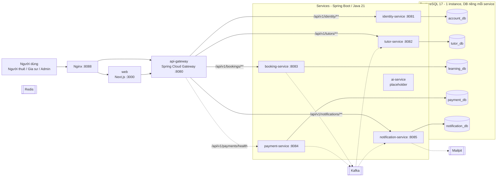
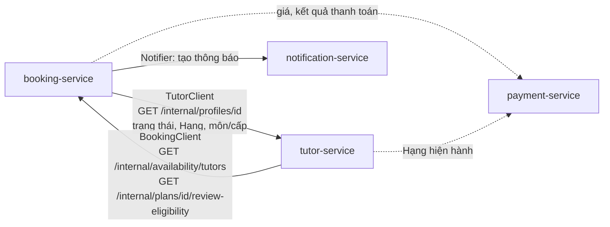
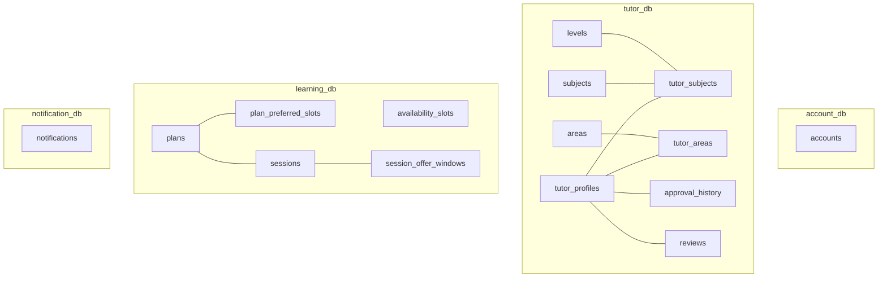
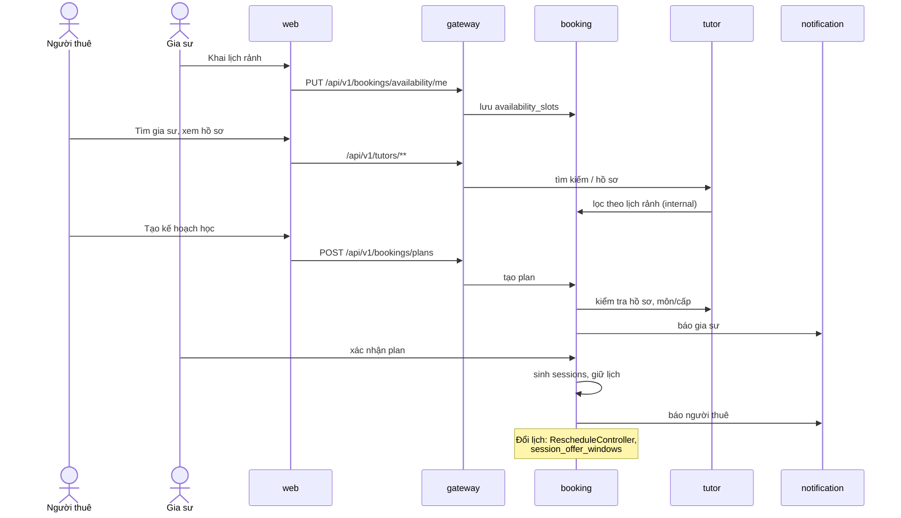

# Sơ đồ dự án

Sơ đồ Mermaid (xem được trên GitHub, VS Code). Bản ảnh PNG/SVG: [docs/diagrams/](../diagrams/). Nét liền: đã có trong code. Nét đứt: dự kiến theo [overview](overview.md) và [domain map](domain-map.md).

## 1. Triển khai (Docker Compose)

## 2. Gọi nội bộ giữa service (REST + JWT nội bộ)

JWT do `identity-service` phát (`JwtIssuer`); gateway chuyển tiếp nguyên vẹn, mỗi service tự kiểm tra (`common-core`).

## 3. Dữ liệu theo service

Liên kết xuyên DB chỉ qua ID (không khóa ngoại): `plans`/`sessions` tham chiếu tài khoản và gia sư bằng ID.

## 4. Luồng đặt học chính

