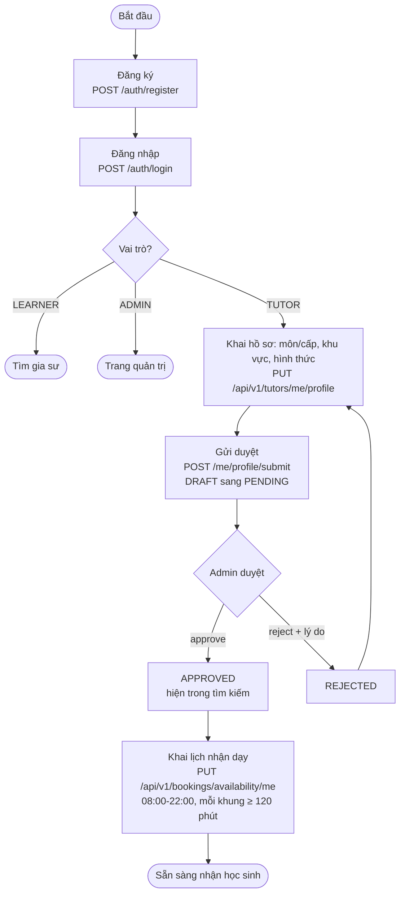
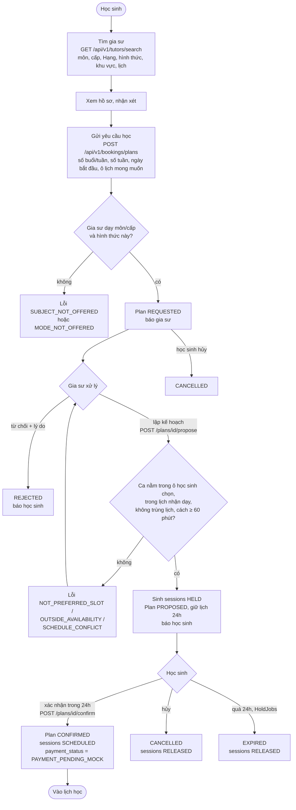
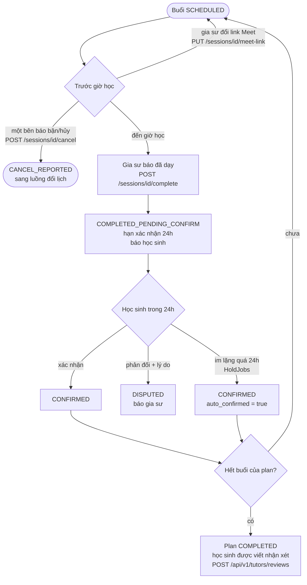
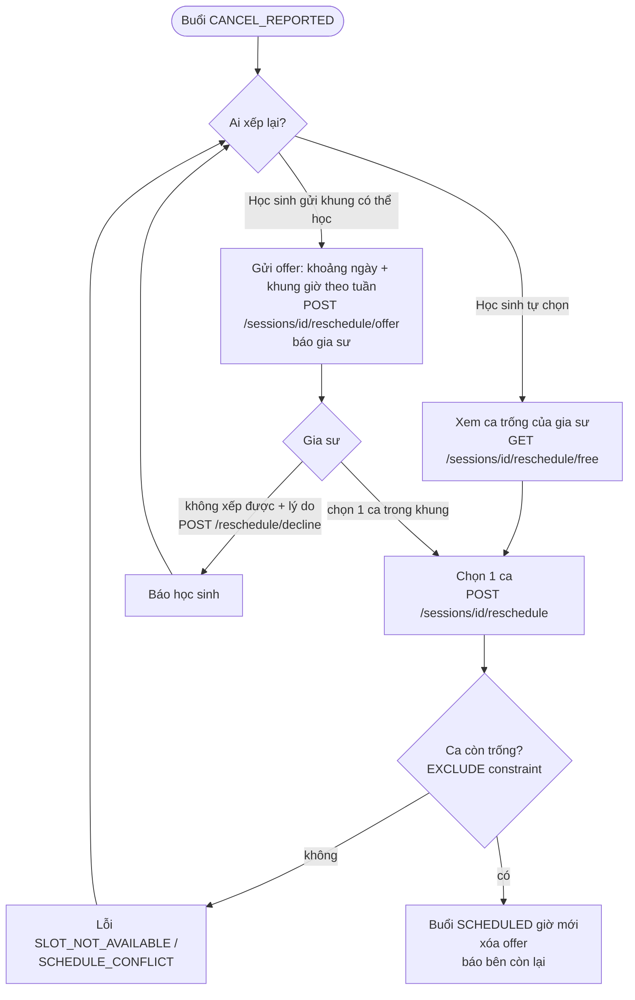
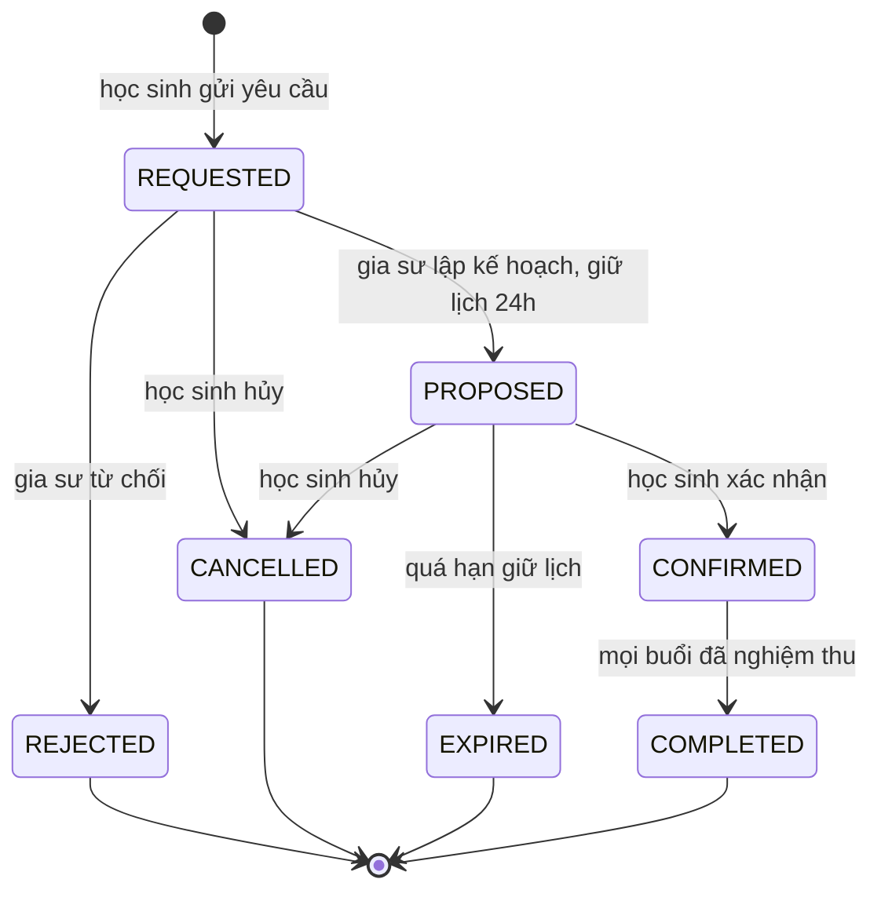
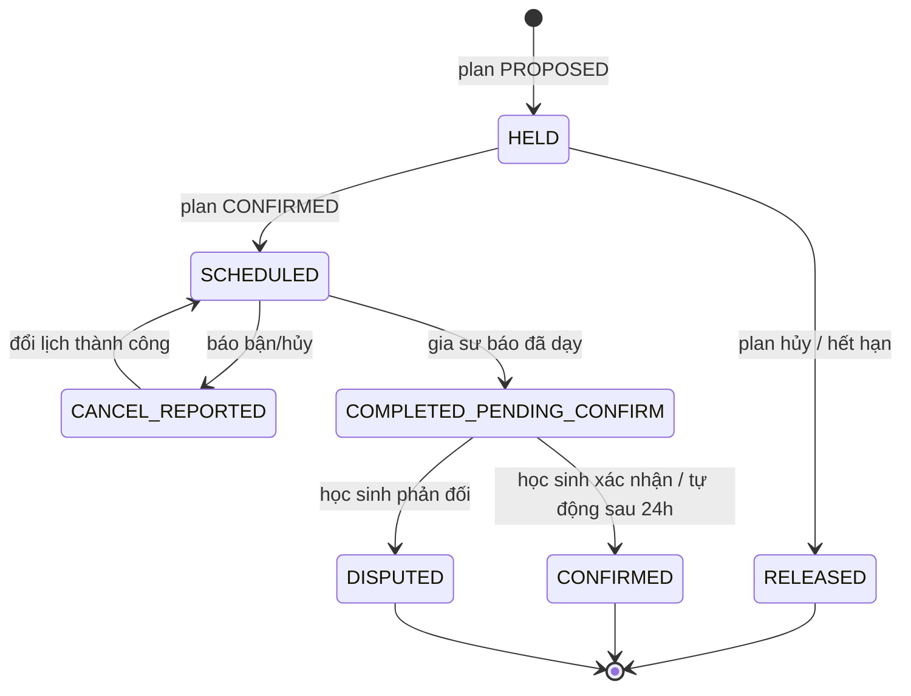

# Luồng hoạt động

Theo code hiện tại của `booking-service`, `tutor-service`, `identity-service`. Mỗi bước gửi thông báo đi qua `notification-service` (`POST /api/v1/notifications/internal`).

Bản ảnh PNG/SVG: thư mục [docs/diagrams/](../diagrams/).

## 1. Đăng ký, đăng nhập, duyệt hồ sơ gia sư

## 2. Đặt học: yêu cầu, lập kế hoạch, xác nhận

## 3. Buổi học: dạy, nghiệm thu, phản đối

## 4. Đổi lịch buổi đã báo bận/hủy

## 5. Trạng thái kế hoạch (plans.status)

## 6. Trạng thái buổi học (sessions.status)

