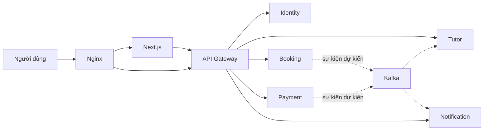

# Tổng quan kiến trúc

Đọc cùng [ranh giới nghiệp vụ](domain-map.md), [cây repo](../repository-layout.md) và [ADR 001](../decisions/001-service-boundaries.md). Cách chia service/module là thiết kế của repo dựa trên năm tài liệu nguồn; danh sách service chưa được tài liệu gốc chốt sẵn.

## Thành phần

| Thành phần | Cổng local | Database / tài khoản DB |
|---|---|---|
| api-gateway | 8080 | Không có database |
| identity-service | 8081 | account_db / account_app |
| tutor-service | 8082 | tutor_db / tutor_app |
| booking-service | 8083 | learning_db / learning_app |
| payment-service | 8084 | payment_db / payment_app |
| notification-service | 8085 | notification_db / notification_app |
| assessment-service | Chưa cấp | Chưa có ứng dụng; khảo thí mức 2 theo P16 |
| care-service | Chưa cấp | Chưa có ứng dụng; chăm sóc khách hàng và vai trò CSKH theo P18 |
| ai-service | Chưa cấp | Chỉ có README; trợ lý AI mức 2 theo P17 |
| web | 3000 | Không sở hữu dữ liệu nghiệp vụ |

Cổng 8081–8085 là cổng mặc định của ứng dụng khi chạy local. Trong Compose, các service này chỉ được truy cập qua mạng nội bộ và gateway. Nginx local dùng cổng 8088.

Đổi tên service vẫn giữ database, DB username và biến môi trường legacy. Mỗi service sở hữu database và migration Flyway riêng; local dùng chung một PostgreSQL instance. Không đổi hoặc xóa volume để đồng bộ tên.

Nét đứt biểu thị giao tiếp dự kiến; khung chưa có producer/consumer nghiệp vụ. REST phục vụ yêu cầu cần phản hồi trực tiếp. Khi phối hợp lịch/tiền, triển khai outbox, chống xử lý lặp và đối soát; không giả định transaction chung xuyên database.

Booking sở hữu lịch rảnh, giữ chỗ, kế hoạch, kỳ/buổi học, đổi lịch, gia hạn và vụ việc. Giữ/chốt lịch thuộc cùng chủ dữ liệu để transaction và khóa có hiệu lực. Payment sở hữu bảng giá, giao dịch và sổ tiền; booking lưu snapshot giá/Hạng/phiên bản đã thỏa thuận. Tutor sở hữu hồ sơ, danh mục, tìm kiếm, nhận xét, EXP và Hạng.

## Phần đã có trong khung

- Entrypoint Spring Boot/Java 21 và Next.js/TypeScript, cùng cấu hình build và chạy local.
- Gateway cấu hình năm route health `/api/v1/{identity|tutors|bookings|payments|notifications}/health`, chuyển đến `/actuator/health` của service tương ứng. Chưa có API nghiệp vụ.
- Các trang `/`, `/learner`, `/tutor`, `/admin` là trang khung, chưa có xác thực/phân quyền frontend. `/learner` là giao diện tài khoản Người thuê; người học không phải vai trò riêng.
- Compose có PostgreSQL, Kafka, Redis, Mailpit, các ứng dụng và Nginx HTTP trên loopback. Producer/consumer, cache và gửi email nghiệp vụ chưa được tích hợp.
- Module có README là vị trí thiết kế. Chưa có ERD chi tiết, JWT, outbox, thanh toán, EXP hoặc xử lý tranh chấp.

Lệnh chạy và kiểm tra nằm trong [README dự án](../../README.md). Có cấu hình hoặc entrypoint chưa đồng nghĩa toàn bộ luồng nghiệp vụ đã hoạt động.

## Tích hợp và vận hành dự kiến

Mailpit nhận email local. Meet là liên kết do gia sư nhập/cập nhật; Leaflet bổ sung khi triển khai giao diện địa bàn. API mô hình ngôn ngữ (nhà cung cấp chờ chốt, Gemini đang cân nhắc) chỉ gọi từ ai-service ở backend, không gửi dữ liệu liên hệ, thanh toán hay bằng chứng. Bằng chứng riêng và video chưa duyệt đi qua API có kiểm tra quyền; không đặt vào `web/public`.

Prometheus/Grafana, HTTPS/Certbot, backup/restore, GHCR và deploy VPS mới có vị trí dành sẵn trong infra/docs. CI hiện cấu hình Maven verify và web build/typecheck; chưa publish hoặc deploy.

Nguồn kiến trúc: `Tai lieu/Kien_truc_va_tich_hop_nen_tang_gia_su.docx`. Xem danh sách nguồn đầy đủ trong [domain map](domain-map.md). Khảo thí, trợ lý AI và chăm sóc khách hàng là service con theo P16–P18 (mức 2); không thêm LMS/đăng ký khóa học, SSO hoặc cổng tuyển dụng.
