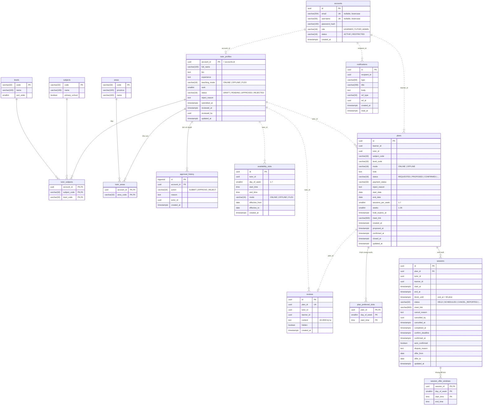

# ERD cơ sở dữ liệu

Sinh từ migration Flyway (`server/services/*/src/main/resources/db/migration`). Mỗi service một database riêng trên cùng instance PostgreSQL.

- Nét liền: khóa ngoại thật trong cùng database.
- Nét đứt: liên kết logic bằng ID, không có khóa ngoại (khác database hoặc cố ý không ràng buộc).

Bản ảnh: [erd.png](../diagrams/erd.png), [erd.svg](../diagrams/erd.svg).

